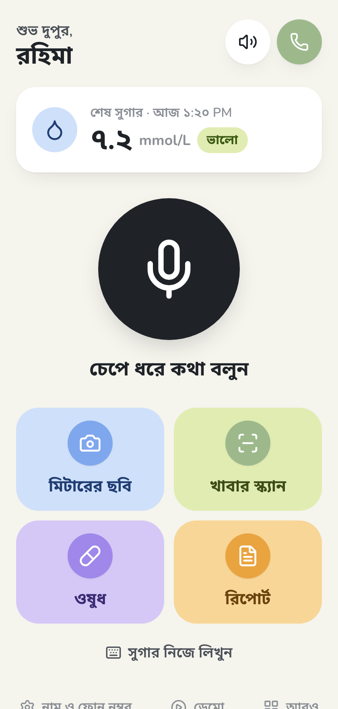
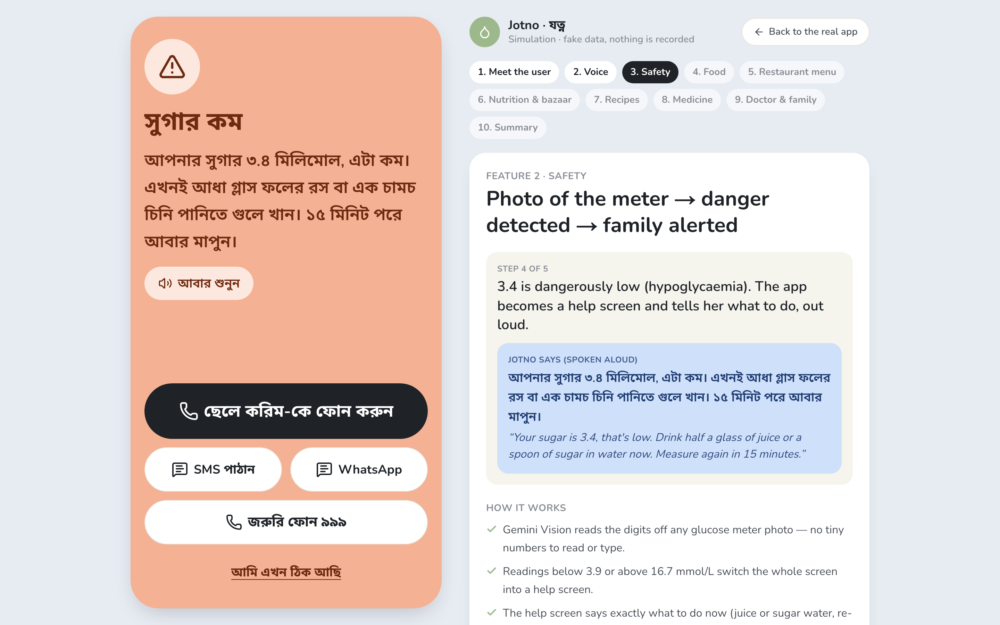
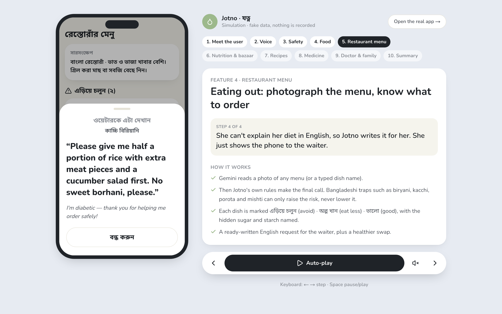
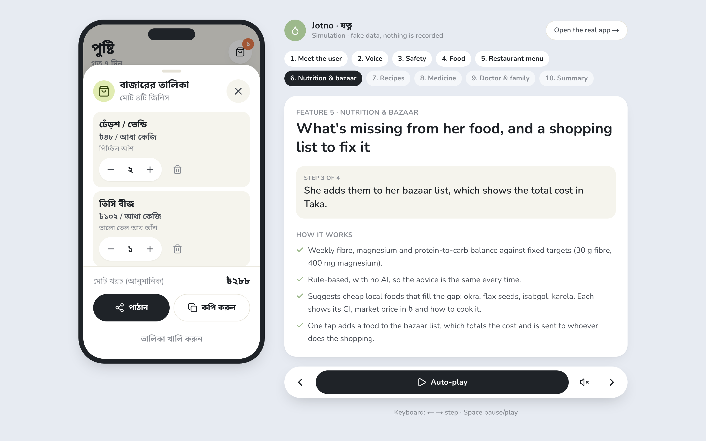
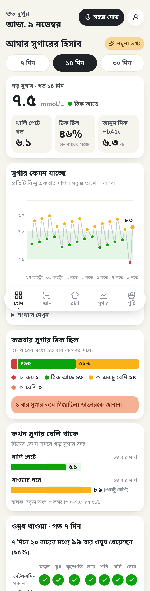
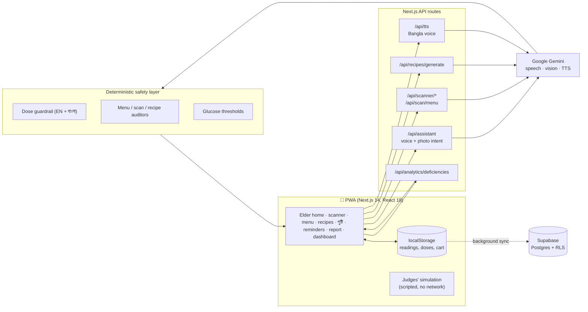

<div align="center">

# যত্ন · Jotno

### A diabetes companion for people who have never used an app

**Speak in Bangla. Take a photo. Jotno takes care of the rest.**

Voice-first and picture-first diabetes care for elderly Bangla speakers: sugar logging,
low-sugar emergencies, food and menu checks, recipes, a bazaar list in Taka, medicine
reminders and a doctor report. Everything is spoken aloud in Bangla.




</div>

---

## 👩‍⚖️ Judges: see the whole app in 3½ minutes

You don't need a microphone, camera, login or API key.

1. Run the app (see [Quick start](#-quick-start)) and open it on a laptop.
2. Click **▶ Watch the simulation**, to the right of the app frame.
3. A scripted week plays inside the real app, using the app's own components. English captions sit beside it, with
   translations of every Bangla line and a short "how it works" note for each feature.

Shortcuts: **← →** step · **Space** pause · **Esc** back to the real app.
You can also open **`/demo`** on any device for a shareable stand-alone version.



---

## The problem

Bangladesh has about **13.9 million adults living with diabetes**
([IDF Diabetes Atlas, 2024](https://diabetesatlas.org/data-by-location/country/bangladesh/)).
Many of them are older, read little, have weak eyesight, and don't use English.
Diabetes apps assume the opposite: small text, typed numbers, English menus, calorie tables built for Western food.

So our user is **Rahima Begum, 68, from Dhaka**. She has type 2 diabetes, struggles to read the
digits on her glucose meter, eats rice three times a day, and her son lives in another city.
**Every design decision in Jotno starts from her.**

## The solution

| Rahima… | Jotno… | How |
|---|---|---|
| **says** "আমার সুগার সাড়ে নয়, খাওয়ার পরে" ("my sugar is nine and a half, after eating") | logs **9.5 mmol/L, after a meal**, reads it back for her to confirm, then gives simple advice aloud | Push-to-talk → Gemini speech-to-intent → confirm sheet → Gemini Bangla TTS |
| **photographs her meter**, which reads 3.4 | switches the whole screen into a **low-sugar help screen**: what to do now, a one-tap call to her son, a prefilled SMS/WhatsApp, and 999 | Gemini Vision + fixed clinical thresholds (< 3.9 or ≥ 16.7 mmol/L) |
| **points the camera at her plate** | gives a traffic-light answer (ভালো / অল্প খান / এড়িয়ে চলুন: good / eat less / avoid) plus one practical sentence | Gemini multimodal live scan; GI and glycemic-load rules recheck every item and can only raise the risk |
| **photographs a restaurant menu** | marks every dish, names its hidden sugar and starch, and writes an **English request she can show the waiter** | Gemini reads the menu; **rules make the final call** |
| **eats too little fibre** | shows what's missing this week and suggests **cheap local foods with their ৳ price**, then builds a **bazaar list** her son gets on WhatsApp | Rule-based nutrition engine (no AI) with a fixed local catalogue |
| **has karela, dal and okra at home** | writes a **low-GI recipe using only those ingredients**, plus the **order to eat in** (vegetables → protein → rice) | Gemini recipe + a rule-based checker that strips added sugar and starch |
| **forgets her Metformin** | **says** "it's time for Metformin" at the right time; she taps খেয়েছি ("I took it") | Spoken reminders + PWA notifications, never a dose |
| **visits her doctor** | gives a **printable report**: averages, lows, time-in-range and medicine adherence, Bangla for her and English for the doctor | Shared as a link whose data lives in the `#fragment`, so it never reaches a server |

<table>
<tr>
<td width="50%"></td>
<td width="50%"></td>
</tr>
<tr>
<td align="center"><b>Restaurant menu check</b>: every dish rated, with a waiter script</td>
<td align="center"><b>পুষ্টি + bazaar</b>: fill nutrition gaps with local food in ৳</td>
</tr>
</table>

### For family and doctors: the dashboard



The **আরও** ("more") screen turns her readings into graphs a caregiver can read at a glance:

- **Average sugar**, with the change from the previous period ("০.৬ কম — ভালো হচ্ছে", 0.6 lower and improving)
- **Trend graph** over the green target band, one dot per reading
- **How often sugar was in range** (low / OK / slightly high / high), with lows called out in words
- **When sugar runs high**: fasting, after meals or at bedtime
- **Medicine grid**: ✓ taken, ✗ missed, for the last 7 days
- Estimated HbA1c, a 7/14/30-day filter, and a table view under every graph

Every colour comes with a word and an arrow, so the dashboard still reads in black-and-white
and for colour-blind family members.

<br clear="right"/>

---

## 🛡️ Safety by design

Medical apps for vulnerable users have to fail safely. These rules are enforced in code, not left to prompts:

- **Nothing is saved until confirmed.** Speech and photos can be misread, so every reading is read back
  and needs a tap on ঠিক আছে ("OK").
- **Never a medicine dose.** An English and Bangla guardrail refuses any insulin or tablet dosing question
  (`src/lib/safety`, `src/lib/assistant/safety.ts`). Reminders say "take it as your doctor said".
- **AI suggests, rules decide.** Deterministic auditors double-check Gemini, and **they can raise risk but never lower it**:
  - live scans recompute glycemic load and apply GI/GL thresholds (`src/lib/ai/multimodal-guard.ts`);
  - menus apply trap keywords for Bangladeshi high-GI foods such as biryani, kacchi, porota and mishti (`menu-auditor.ts`);
  - recipes are stripped of any sugar or starch she didn't have (`recipe-auditor.ts`).
- **Dangerous readings escalate.** Below 3.9 or above 16.7 mmol/L, the app becomes a help screen with family call, SMS,
  WhatsApp and 999.
- **Private by default.** Readings live on the phone first. The shared report travels in the link's `#fragment`,
  which browsers never send to a server. Supabase tables use row-level security.
- **Works when things break.** It is a PWA with an offline page. Readings sync to the server in the background when online. If neural TTS
  is down or over quota, it falls back through several models and then to the browser voice.

## 👵 Elder-first design

- **One screen, one big button.** Push-to-talk on a large mic button, plus four picture tiles. No menus to learn.
- **Everything spoken, in a natural Bangla voice** (Gemini TTS), with a "শুনুন" (listen) button to replay.
- **Bangla digits, mmol/L, Taka.** These are the units used in Bangladeshi clinics and markets.
- **Large type, high-contrast pastel tiles and big tap targets** on every screen she uses.
- **Local food knowledge.** It reasons about bhat, dal, bhorta, korola, dherosh, kacchi and roshogolla, not kale and quinoa.

---

## 🏗️ Architecture



| Layer | Choice | Why |
|---|---|---|
| App | Next.js 14 (App Router), React 18, TypeScript, Tailwind | One codebase for web and an installable PWA |
| AI | Google Gemini (flash models with automatic fallback) | Bangla speech, vision and natural Bangla TTS in one API |
| Safety | Pure TypeScript rule engines + Zod schemas | Testable, deterministic, and they can't be talked out of a rule |
| Data | localStorage first, Supabase (Postgres + RLS) sync | Works offline; patient data stays on the phone |
| Charts | Recharts + plain HTML/SVG | Accessible, light, and consistent with the app's colours |
| Offline | `@ducanh2912/next-pwa` (Workbox) | Installable, with an offline fallback page |

---

## 🚀 Quick start

```bash
git clone https://github.com/sajided/ai-build-con.git
cd ai-build-con
npm install
cp .env.example .env.local     # add your GEMINI_API_KEY (Supabase is optional for the demo)
npm run dev                    # http://localhost:3000
```

| Variable | Needed for |
|---|---|
| `GEMINI_API_KEY` | Voice, photo reading, food and menu scans, recipes, Bangla voice |
| `NEXT_PUBLIC_SUPABASE_URL`, `NEXT_PUBLIC_SUPABASE_ANON_KEY`, `SUPABASE_SERVICE_ROLE_KEY` | Cloud sync (the app works without it) |
| `SCAN_DEMO_FALLBACK` | `true` for demos: sample results when Gemini fails. **Set it to `false` for real patients.** |

The **simulation and the dashboard's sample data need no keys at all**.

```bash
npm test               # 145 tests: safety guardrails, auditors, nutrition engine, report maths, UI flows
npm run build          # production build
npm run demo:voice     # re-record the simulation's Bangla voice clips (needs npm run dev running)
```

## 🗂️ Project map

```
src/
├── app/                    # Screens and API routes
│   ├── page.tsx            # Elder home: push-to-talk, meter photo, tiles
│   ├── dashboard/          # Graphs and insights for family and doctors
│   ├── scanner/ live/      # Live food / bazaar / menu camera scan
│   ├── menusafe/           # Restaurant menu check + waiter script
│   ├── recipes/            # Low-GI recipes from your ingredients
│   ├── deficits/           # পুষ্টি: nutrition gaps + bazaar list
│   ├── reminders/ report/ care/   # Medicines, doctor report, caregiver view
│   ├── demo/               # Stand-alone judges' simulation
│   └── api/                # assistant, tts, scan, recipes, analytics, telemetry…
├── components/
│   ├── demo/               # Simulation script, screens, player, caption panel
│   ├── dashboard/          # SugarInsights graphs
│   └── elder/ care/ deficits/ scanner/ telemetry/
├── lib/
│   ├── ai/                 # Gemini calls + rule-based auditors
│   ├── safety/ assistant/  # Dose guardrails (EN + বাংলা), speech, Bangla helpers
│   ├── nutrition/ cart/    # Nutrition engine, local food catalogue, bazaar list
│   └── care/               # Reminders, adherence, doctor-report maths
└── __tests__/              # Vitest suites per feature
supabase/migrations/        # Schema + row-level security
```

---

## 🔭 What's next

- **Offline speech** for villages with weak signal (on-device Bangla speech recognition)
- **Bluetooth glucose meters**, so readings arrive without a photo
- **Community health workers** (CHWs): one dashboard for the many elders a worker visits
- **Clinical validation** with a Dhaka diabetes clinic before any real-patient use

## ⚠️ Disclaimer

Jotno is a hackathon prototype, **not a medical device**. It gives general food and lifestyle guidance,
never medication doses, and does not replace a doctor. Simulation and sample data are fictional.

## 👥 Team

Built for the hackathon by **sajided**, **Md. Junaid Al Habib Siam** and **bijan-sarkar**.

<div align="center">

**যত্ন means "care". Jotno is built for the people who need it most.**

</div>
